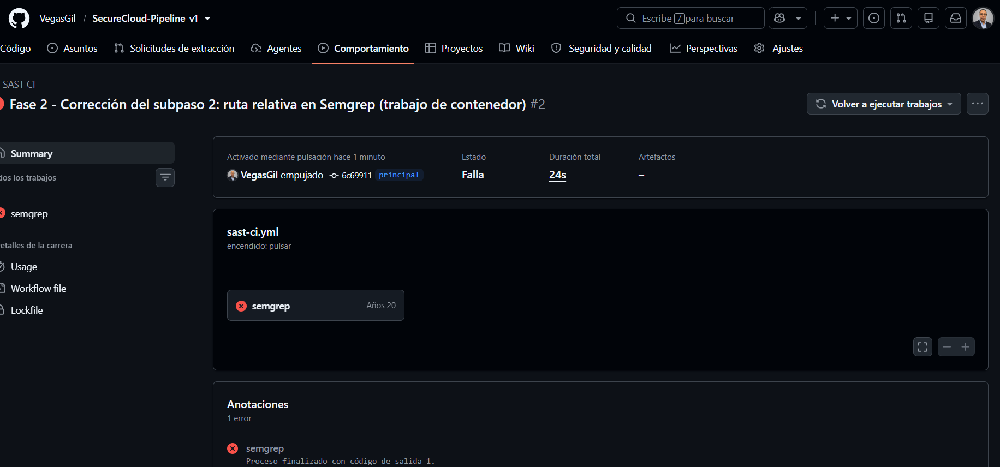

# SecureCloud-Pipeline_v1
Objetivo concreto Crear la estructura inicial del proyecto SecureCloud-Pipeline, instalar sigma-cli y validar una primera regla Sigma local.

mkdir SecureCloud-Pipeline
cd SecureCloud-Pipeline
git init

mkdir -p detections/windows tests

python -m venv .venv
# Linux/macOS:
source .venv/bin/activate
# Windows:
# .venv\Scripts\activate
# deativate

python.exe -m pip install --upgrade pip
pip install -r requirements.txt

### Flujos de trabajo activos
- `detection-ci.yml` → Valida reglas Sigma (Fase 1).
- `sast-ci.yml` → Semgrep sobre `app/` (Fase 2, SAST).
- `sca-ci.yml` → Trivy sobre dependencias de `app/` (Fase 2, SCA).

